  <a href="https://feb20th.click">
    <picture>
      <source media="(prefers-color-scheme: dark)" srcset="assets/header-dark.svg">
      
    </picture>
  </a>

<h2 align="center">Hi, I'm Duy An 👋</h2>

  Full-stack developer and third-year IT student who loves turning ideas into complete, working products.

 

I'm a third-year Information Technology student at **UTH** (Ho Chi Minh City University of Transport), and alongside university I'm in the final semester of **VTC Academy**'s Full-Stack Development program. I enjoy building a product end to end: designing the database, writing the API and shipping a clean, responsive interface on top. Most of my recent work lives in TypeScript monorepos with NestJS or Express on the backend and React or Next.js on the frontend.

I'm also a big fan of **vibe coding**. I pair with Claude and Claude Code to get from an idea to a working prototype fast, then read, test and refine the code myself so I understand every part of it.

- 🔭 Currently building **[TaskFlow](https://github.com/NayuD06/TaskFlow)** ([live](https://task-flow-sigma-lilac.vercel.app)), a project and task manager with Kanban, list and calendar views
- 🎓 VTC capstone: **[Nexora Travel](https://www.nexora-travel.agency/)**, a team-built booking site for small-group tours around Vietnam
- 🌱 Open to internships and freelance projects
- 🌐 Portfolio: **[feb20th.click](https://feb20th.click)**
- 📫 Email: **[nayud.2006@gmail.com](mailto:nayud.2006@gmail.com)**

## 🛠️ Tech stack

## 🚀 Featured projects

| Project | What it is | Built with |
| --- | --- | --- |
| **StudyMind AI** [Code](https://github.com/NayuD06/StudyMind-AI) · [Case&nbsp;study](https://feb20th.click/projects/studymind-ai) | Study material sharing platform with semantic search and AI Q&A over PDFs, an in-browser PDF reader, a moderation dashboard and 55 API tests running in CI | React · Express · Prisma · MySQL · FastAPI · Qdrant |
| **EduForge AI** [Code](https://github.com/NayuD06/EduForge-AI) · [Case&nbsp;study](https://feb20th.click/projects/eduforge-ai) | Course and online exam platform: 8 question types, randomized timed exams with auto-grading, live timer sync and AI question generation from PDFs (in progress) | NestJS · Next.js · PostgreSQL · Redis · Claude API |
| **SpendWise** [Code](https://github.com/NayuD06/DEVOPS-Money-Manager) · [Live](https://devops-money-manager-jzgu.vercel.app) · [Case&nbsp;study](https://feb20th.click/projects/spendwise) | Personal finance tracker with JWT auth, category reports and Excel support, Jest tests, Prometheus metrics with alert rules and a GitHub Actions release pipeline | React · Express · MongoDB · Docker · Prometheus |
| **Online E-Learning** [Code](https://github.com/NayuD06/online_elearning) · [Case&nbsp;study](https://feb20th.click/projects/online-elearning) | E-learning platform with courses and lessons, quizzes, enrollments and orders, reviews, completion certificates and an admin dashboard | PHP · Laravel · MVC · SQL |
| **Digital Map Pathfinding** [Code](https://github.com/NayuD06/digital-map-pathfinding) · [Case&nbsp;study](https://feb20th.click/projects/digital-map-pathfinding) | Team project comparing Dijkstra and A* shortest paths on a real district map from OpenStreetMap, drawn on an interactive Leaflet map | Python · FastAPI · NetworkX · React · Leaflet |
| **TaskFlow** [Code](https://github.com/NayuD06/TaskFlow) · [Live](https://task-flow-sigma-lilac.vercel.app) · [Case&nbsp;study](https://feb20th.click/projects/taskflow) | Project and task manager with Kanban, list and calendar views, drag and drop, tags and filters, reminders, a stats dashboard and Vietnamese/English, installable as a PWA | React · Express · MongoDB · TanStack Query · dnd-kit |

## 🎲 Fun facts

- ☕ My fuel is **bạc xỉu**, Saigon's milky iced coffee
- 🎮 I play games to unwind after coding
- ⚽ Big football fan

## 🤝 Let's connect

  
  
  
  

Thanks for stopping by ✨

